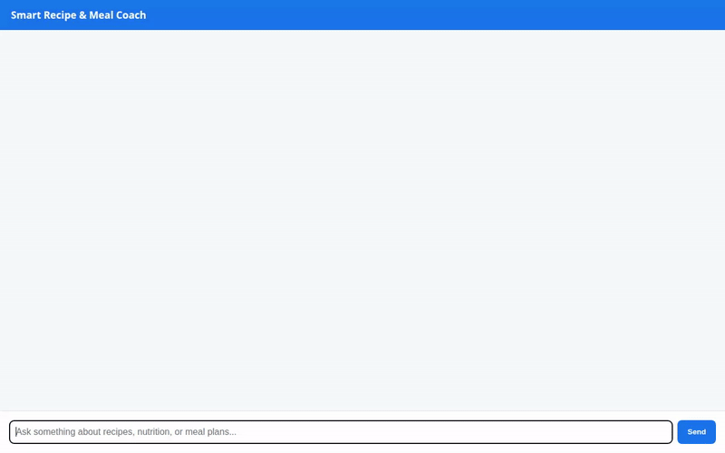

# Smart Recipe & Meal Coach

An intelligent AI recipe and meal planning assistant built with the **Agent Development Kit (ADK)**, **Vertex AI Agent Runtime**, and **Google Cloud Services**. The Smart Recipe & Meal Coach helps users discover recipes, calculate nutrition, manage pantry items, and plan personalized meals with rich adaptive UI elements and generated dish visualizers.



---

## Key Features & Wired Services

- **Vertex AI Memory Bank Service**: Remembers user dietary preferences, restrictions, allergies, and favorite ingredients across sessions.
- **Google Cloud Firestore Backend**: Real-time database hosting a `recipes` collection storing recipe titles, ingredients, instructions, macro breakdowns, and dietary tags.
- **Google Cloud Storage (GCS)**: Hosts public dish photos generated on-the-fly (`smart-recipe-coach-b73a` bucket).
- **Gemini Image Generation (`gemini-3.1-flash-lite-image`)**: Generates appetizing food photography for dishes, saves local artifacts, and publishes public HTTPS URLs.
- **Open Food Facts Public API Integration**: Real-time lookup of ingredient nutrition facts (calories, protein, carbs, fat per 100g).
- **AgentEngineSandboxCodeExecutor**: Secure Python sandbox execution for calculating caloric totals, macro splits, and recipe ingredient scaling.
- **A2UI (Agent-to-User-Interface)**: Generates structured, responsive UI cards using `A2uiSchemaManager` (v0.8) and the Basic Catalog.
- **FastAPI Web Chat UI & A2A Client**: Light, standalone web frontend and proxy for interacting with deployed Vertex AI Agent Engine instances.

---

## Built-In Agent Tools

1. `search_recipes`: Query recipes by keyword, title, or dietary tag (`vegan`, `high-protein`, `gluten-free`, `keto-friendly`).
2. `get_recipe_details`: Fetch full ingredients, cooking steps, macros, and dietary tags for a given recipe ID.
3. `add_recipe`: Add new custom recipes into the Firestore database.
4. `get_ingredient_nutrition_facts`: Retrieve ingredient nutrition facts from the Open Food Facts API.
5. `generate_recipe_image`: Generate dish imagery using Imagen on Vertex AI, store to GCS, and return public URLs.
6. `AgentEngineSandboxCodeExecutor`: Run Python code blocks in a sandbox to compute complex nutritional math.

---

## Local Setup & Development

### Prerequisites
- Python 3.11+
- `uv` package manager installed

### Running the Agent & Playground Locally

1. Install app dependencies:
   ```bash
   uv sync
   ```

2. Seed the Firestore recipe database:
   ```bash
   uv run python seed_recipes.py
   ```

3. Launch the ADK Web Playground locally:
   ```bash
   uv run adk web . --port 8080 --reload_agents
   ```

4. Alternatively, run the FastAPI web frontend:
   ```bash
   cd frontend
   uv run python main.py
   ```
